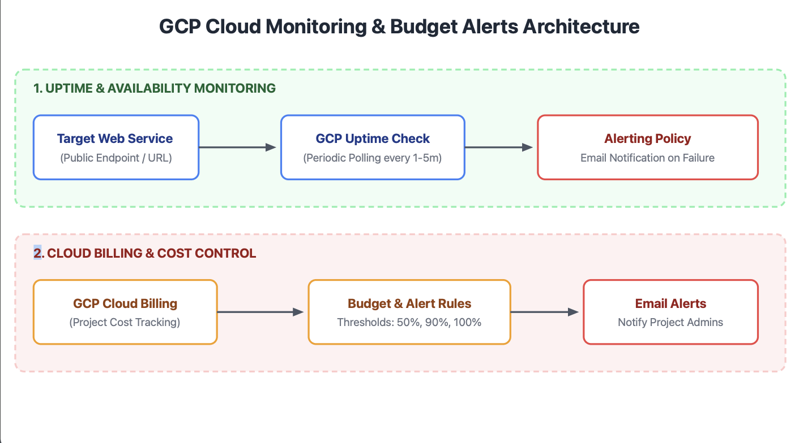
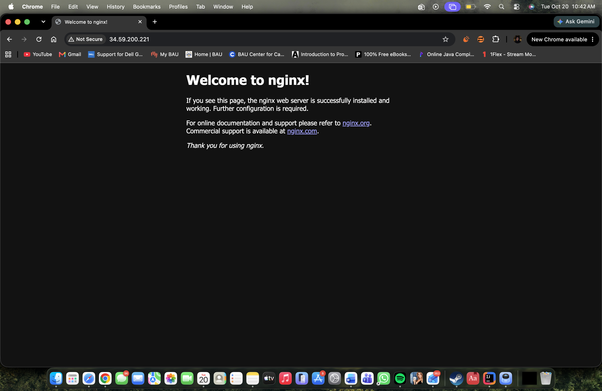
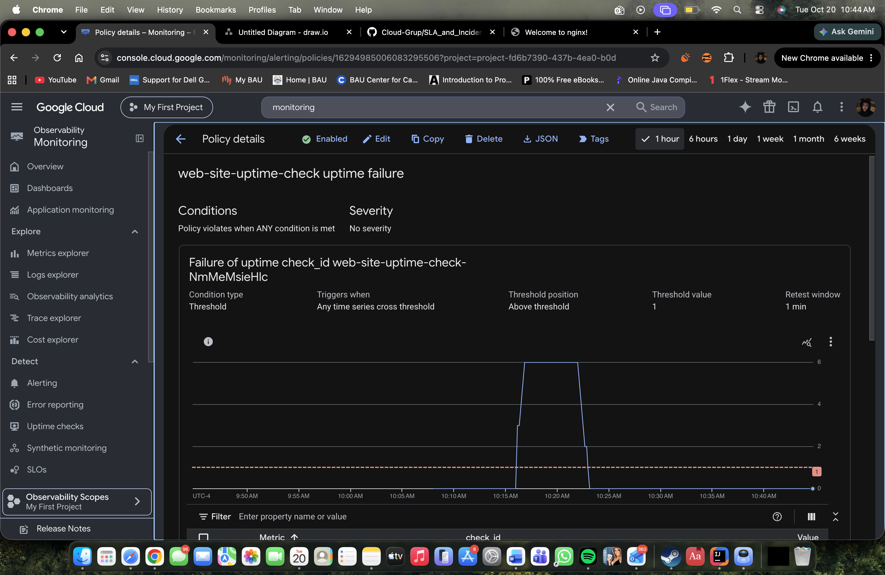
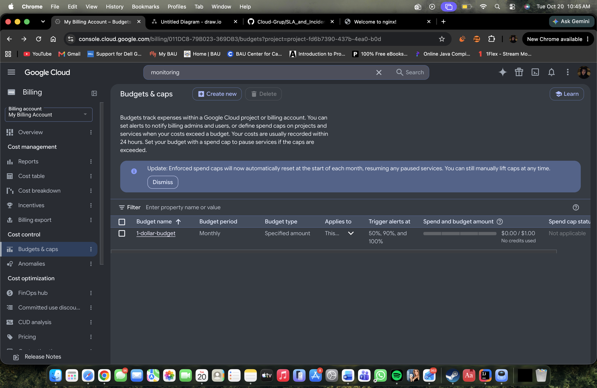
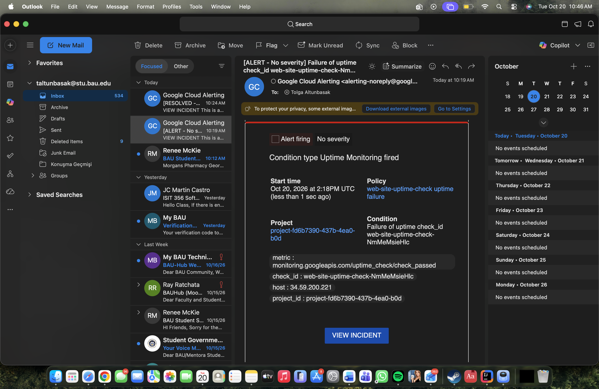
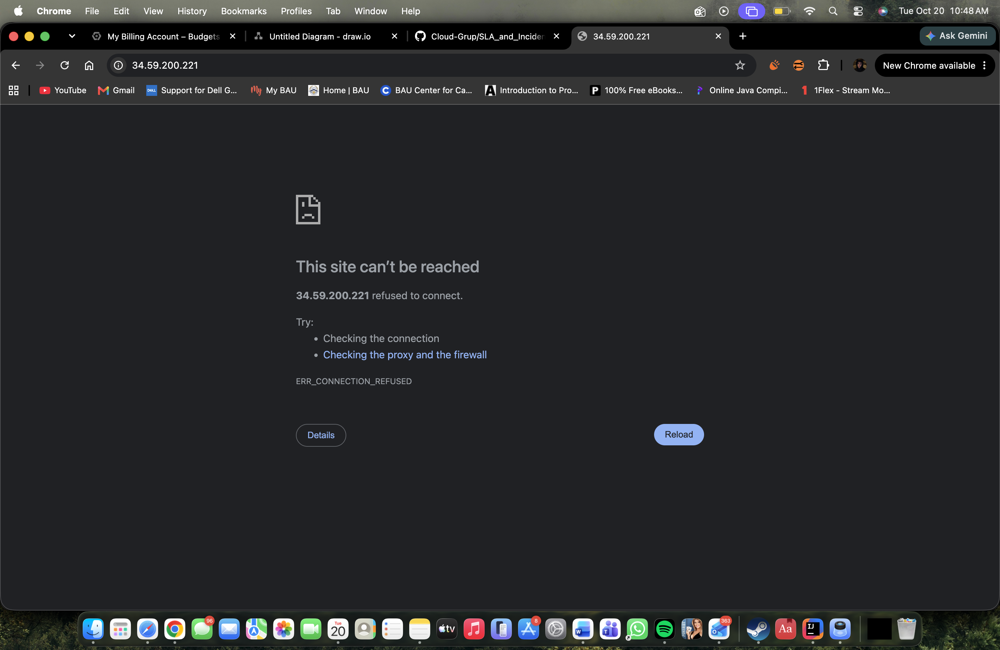

# Google Cloud Monitoring, Uptime Checks and Budget Alerts

## Team Information
* **Team Code:** 2U2KTA
* **Members:** Muhammed Tigli, Atakan Avukat, Osman Uygar, Tolga Altunbasak, Alp Dogan

---

## Live Deployment
* **Web Application URL:** `http://34.59.200.221/`

---

## Architecture Diagram

---

## Deliverables & Evidence
1. **Architecture Diagram:** Comprehensive architecture diagram showing the user, GCE instance running Nginx, Google Cloud Monitoring probes, and email notifications.
2. **Web Server:** Deployed on an `e2-micro` VM running Debian Linux and Nginx.
3. **Uptime Check & Alerting:** Configured with 1-minute check frequency and email alert notifications upon failure.
4. **Budget Alert:** Set to $1 target budget with alerts triggered at 50%, 90%, and 100% thresholds.
5. **Outage Drill & Incident Report:** Completed and documented in [SLA_and_Incident_Report.md](SLA_and_Incident_Report.md).

---

## Evidence Screenshots

### 1. Live Website Running

### 2. Uptime Check Configured

### 3. $1 Budget Alert

### 4. Outage Drill (Service Stopped)

### 5. Alert Email Received

